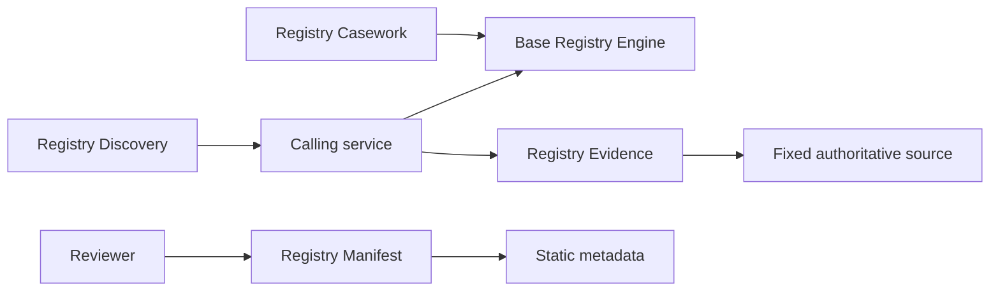

Registry Stack is a set of focused products. Each product owns its data, configuration, API, and
operational boundary. Base Registry Engine (BReg) is the governed record service.

## Product boundaries

- Base Registry Engine owns writable PostgreSQL records, governed changes, history, events, and
  its record API.
- Registry Evidence evaluates predefined requirements against fixed sources and returns signed,
  minimum-disclosure assertions.
- [Registry Manifest](../../reference/glossary/#registry-manifest) validates and renders portable static metadata.
- Registry Discovery serves a curated public index. Current contracts index Evidence providers.
- Registry Casework coordinates human review while mutations remain with the source system.
- Registry Coordinator runs reviewed, finite workflows across durable waits. Receiving products
  keep authority over every effect.
- Registry Messaging delivers one operational message per request through operator-configured
  providers. The caller decides why, when, and to whom.
- Registry Scheduling keeps one capacity ledger in PostgreSQL. Holds and appointments are
  created only inside Scheduling.
- Registry Render produces byte-stable PDF documents from registry data using embedded Typst.
- Registry Adapter serves a declared API over an existing source system, or ingests source
  pages into a reviewed projection.
- Registry Document Store holds document bytes in custody and releases an exact, verified
  version to a recipient a document grant names. It is pre-1.0 and held out of releases.
- Registry Platform supplies bounded primitives. It does not decide product policy. Its SQLite
  boundary opens a database read-only and installs a statement authoriser that denies by default.

{/* Evidence: crates/registry-coordinator/Cargo.toml; crates/registry-messaging/Cargo.toml;
    crates/registry-scheduling/Cargo.toml; crates/registry-render/Cargo.toml;
    crates/registry-adapter/Cargo.toml; crates/registry-documents/Cargo.toml;
    docs/site/src/data/repo-docs.yaml (registry-documents, unreleased and held out of releases);
    products/coordinator/README.md; products/messaging/README.md; products/scheduling/README.md;
    products/render/README.md; products/adapter/README.md; products/documents/README.md;
    crates/registry-platform-sqlite/src/schema.rs (SQLITE_OPEN_READ_ONLY);
    crates/registry-platform-sqlite/src/statement.rs (install_authorizer, authorize). */}

Products are configured and deployed independently. A package, credential, trust decision, or audit
record from one product does not silently authorise another.

## Trust boundaries

| Boundary | Invariant |
| --- | --- |
| BReg write boundary | Only compiled model operations and authorised profiles can mutate PostgreSQL records. |
| Evidence source boundary | Every request origin, method, and path comes from the reviewed package and its pinned Adapter pack route. Credentials, the acquisition deadline, and the response budget come from the operator runtime file, which must match the governed connection policy. Caller input selects none of them. |
| Evidence assertion boundary | Only declared concepts and value forms enter the signed assertion. |
| Manifest publication boundary | Output is descriptive static metadata and grants no runtime authority. |
| Discovery selection boundary | A selection is inert until an application validates and accepts it locally. |
| Casework decision boundary | Casework records review. The source system retains mutation authority. |

No [shared root](../../reference/glossary/#deployment-bundle) activates the products atomically.
Operators record and recover each product revision separately.

{/* Evidence: products/evidence/contracts/bundle.schema.yaml (sourceConnections, sources);
    products/evidence/contracts/runtime.schema.yaml (sourceConnections, sourceAcquisition);
    products/evidence/contracts/security-invariant-matrix.yaml (V1-I09). */}

### What crosses a boundary

Only a product's documented contract crosses its boundary: an authorised BReg API response, a
signed Evidence assertion, or static Manifest metadata. The source stays responsible for the
correctness and currentness of its data. A signed Evidence assertion names the requirement it
supports and the configuration revision it was evaluated under. It does not establish that the
source's data was correct or current. An Evidence error body carries static text and a trace
identifier only. It never carries a source URL, source response, credential, or script
diagnostic.

{/* Evidence: products/evidence/contracts/evidence.schema.yaml (supportsRequirement, revision);
    products/evidence/contracts/problem-contract.yaml (exact_members, prohibited). */}

## Composition

Applications integrate through documented APIs and portable artifacts. BReg can supply governed
records through its own API. Registry Evidence can call an explicitly configured source. Manifest
output can describe a service without controlling it. Registry Evidence does not read a metadata
manifest. Discovery returns inert metadata that an
application must validate and accept locally.

A fixed authoritative source remains outside the Registry Evidence product boundary. An
authenticated Base Registry Engine route can serve as such a source when its own authorisation
permits the request; that composition does not merge the two products' trust boundaries.

The [Registry Manifest reference](../../products/registry-manifest/reference/) owns the current
metadata keys and field schemas.

{/* Evidence: crates/registry-breg/src/api/mod.rs; crates/registry-evidence/src/server.rs;
    crates/registry-manifest-core/src/lib.rs; crates/registry-discovery/src/query.rs;
    crates/registry-evidence/Cargo.toml (no registry-manifest dependency). */}

## Next

- [Concepts](../../start/concepts/)
- [Threat model](../threat-model/)
- [Security overview](../../security/)
