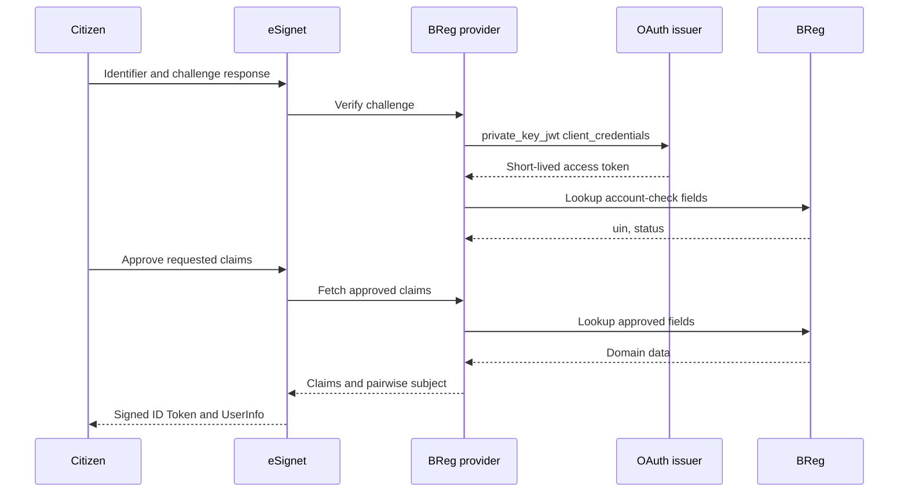

If you run a population registry on Base Registry Engine (BReg) and an
[eSignet](https://docs.esignet.io/) deployment, the
[eSignet BReg provider](https://github.com/registrystack/esignet-relay-authenticator) lets citizens
sign in to public services against your registry.
eSignet keeps the login, the consent screen, and the signed
[OpenID Connect](https://openid.net/specs/openid-connect-core-1_0.html) (OIDC) tokens.
Your registry answers one governed lookup and releases only the fields each citizen approves.
On the registry side that takes one selector profile, one access profile, one runtime entry, and
one client at your issuer, for the provider version your deployment runs.

{/* TODO[evidence]: provider statements on this page (challenge before any call, token request and
cache, account check, consent intersection, the pairwise subject, error mapping, configuration keys
and environment variables, the demo verifier) live in the separate
registrystack/esignet-relay-authenticator repository and cannot be anchored from this one. They were
checked on 2026-10-17 against esignet-relay-authenticator v0.6.1: its README,
docs/esignet-configuration.md, docs/breg-lookup-contract.md, provider/config.go, provider/http.go,
and provider/types.go. Re-verify at each provider release. */}

## How a sign-in reaches your registry

Relying parties talk only to eSignet, which runs the OIDC endpoints and the consent screen and
signs the ID Token and UserInfo response.
The provider, a Go module compiled into the eSignet host, verifies the citizen's challenge, looks
the citizen up in your registry, and hands eSignet the claims to sign.



The citizen's tokens never reach your registry.
The provider authenticates as a `private_key_jwt` client to the OAuth issuer your registry already
trusts.
It asks for a fixed resource and scope set and caches each access token, for five minutes by default.
BReg trusts one issuer only, so the provider's client must be registered there.
An ID Token is addressed to the relying party, not to your registry, and BReg refuses it.

On every call BReg verifies the token's signature, issuer, type, lifetime, and audience, and that
its `azp` or `client_id` is in `allowedClients`.
[What a token must carry](../../operate/breg/#what-a-token-must-carry) lists each requirement.
The token must then satisfy the profile the provider names in `accessProfile`, because naming a
profile grants nothing.
Three claims decide that:

- The principal claim, here `registry_principal`, recorded in the audit journal as the caller.
- The required scope, here `registry:esignet:lookup`, which you grant to the provider's client alone.
- The row claim, here `registry_eligible_status`, which lists the statuses the provider may resolve.

{/* Evidence: crates/registry-breg/src/auth.rs, authenticate_request, accepted_audience,
matched_client_id, required_direct_string; crates/registry-breg/src/runtime_config.rs,
access_token_profile; crates/registry-platform-oidc/src/lib.rs, access_token_profile;
crates/registry-breg/src/api/mod.rs, authorize_profile_claims, verified_row_boundaries. */}

A token that misses any of these gets a refusal, never a narrower answer.
The provider adds its own safeguards:

1. It verifies the challenge before it calls the issuer or your registry.
2. Its first lookup asks only for `account_check_fields`, usually the identifier and a status.
3. eSignet asks for consent on every sign-in.
   The second lookup asks only for approved claims the provider maps and provisions, and an empty
   set makes no call.
4. The OIDC `sub` claim is a keyed hash of the relying party, the client, and the identifier.
   Each relying party sees a different subject, which does not reveal the identifier.

## Grant the provider one lookup

The examples use a `person` Record type on the `population` route with a `uin` identifier field.

### Declare the lookup in the project

Add a selector profile to the Record type and an access profile that grants only that lookup:

```yaml title="population/registry.yaml"
recordTypes:
  - id: person
    route: population
    # fields: uin, status, given-name, family-name, birthdate
    selectorProfiles:
      - id: by-uin
        fields: [uin]

accessProfiles:
  - id: esignet-source
    principalClaim: registry_principal
    requiredScopes: ["registry:esignet:lookup"]
    permissions:
      records:
        - recordType: person
          operations: [lookup]
          readableFields: [uin, status, given-name, family-name, birthdate]
          lookups:
            - selector: by-uin
              valueOrigin: request
          rowBoundaries:
            - field: status
              claim: registry_eligible_status
              operator: in
```

`lookups` ties the grant to `by-uin`, and `valueOrigin: request` lets the provider send the
identifier it verified.
The profile grants no `get`, `list`, or write operation, because the provider never needs one.
The row boundary resolves only Records whose `status` the row claim lists, so an inactive Record
answers like a missing one.

{/* Evidence: crates/registry-breg/src/contract.rs, SelectorProfileSource, LookupPermissionSource,
LookupValueOrigin; crates/registry-breg/src/compiler.rs, validate_selector_profiles,
validate_lookup_permissions; crates/registry-breg/src/api/mod.rs, resolve_lookup_selector. */}

Read the compiled grant:

```sh
bregctl explain access population
```

The `esignet-source` block reads as follows; the rest of the output is omitted:

```text
    profile esignet-source
      principal claim         registry_principal
      operations              ["lookup"]
      required scopes (all)   ["registry:esignet:lookup"]
      allowed purposes (any)  unrestricted
      readable fields         ["birthdate","family-name","given-name","status","uin"]
      writable fields         none
      filterable fields       none
      sortable fields         none
      row restrictions (all)  [{"claim":"registry_eligible_status","field":"status","operator":"in"}]
      lookups                 [{"claimMapping":{},"selector":"by-uin","valueOrigin":"request"}]
```

If `lookups` names a selector the Record type does not declare, `bregctl` refuses the project with
`breg.access-profile.lookup-selector-unknown`.
Without the row boundary it warns `breg.access.profile-unrestricted-rows`, because every Record on
the route could then resolve.

### Admit the provider's client

In the runtime file, list the provider's client in `allowedClients`.
Its `audience` and principal claim must match what the issuer will put in the token:

```yaml title="population/runtime.yaml"
authentication:
  oidc:
    issuer: https://issuer.example.com
    audience: urn:breg:population
    allowedClients: [esignet-source, registry-admin]
  authorityClaims:
    principal: registry_principal
```

Other keys stay as your deployment sets them.
Check the project and the runtime file together:

```sh
bregctl check population --runtime-config population/runtime.yaml
```

It prints `Authoring check passed; registry revision sha256:<digest>.` first and exits `0`.
Then deploy the changed project as
[Check, test, package](../../operate/breg/#check-test-package) describes.

### Issue the provider's token

At your OAuth issuer, register the `esignet-source` client to authenticate with `private_key_jwt`.
Give it an ES256 or RS256 key whose private half the provider reads from a file.
Grant it the `registry:esignet:lookup` scope and nothing that writes.
Configure its access tokens to carry:

- `aud` equal to `urn:breg:population`, the value the provider requests as its `resource`.
- `registry_principal`, naming the provider as the caller.
- `registry_eligible_status`, an array of the statuses that may sign in, such as `["active"]`.

Decode one token issued to this client and confirm each claim before you go on.
A token without the row claim fails every lookup as if no citizen existed.

### Point the provider at the registry

Select the provider with `MOSIP_ESIGNET_AUTHN_PROVIDER=breg` and name its one YAML file in
`REGISTRY_ESIGNET_CONFIG_FILE`.
These keys connect it to the grant:

```yaml title="provider.yaml"
subject_id_type: uin
psut_secret_file: /run/secrets/registry-psut
breg:
  base_url: https://registry.example.com
  route: population
  selector: by-uin
  selector_field: uin
  access_profile: esignet-source
  provisioned_fields: [uin, status, givenName, familyName, birthdate]
  account_check_fields: [uin, status]
token_client:
  token_endpoint: https://issuer.example.com/oauth2/token
  assertion_audience: https://issuer.example.com/oauth2/token
  client_id: esignet-source
  private_key_file: /run/secrets/registry-client.jwk
  key_id: esignet-source-2026-09
  resource: urn:breg:population
  scopes: ["registry:esignet:lookup"]
claim_map:
  sub: $psut
  given_name: givenName
  family_name: familyName
  birthdate: birthdate
```

`route`, `selector`, and `access_profile` name what the project declares; `client_id`,
`resource`, and `scopes` match the issuer and the runtime file.
`selector_field`, `provisioned_fields`, and `account_check_fields` take API names, which default to
the camelCase form of each field ID, so `given-name` becomes `givenName`.
`account_check_fields` must include `selector_field`.
Every claim a citizen may release needs a `claim_map` entry, and `sub` must be `$psut`.
Protect and rotate the two secret files on your own schedule.

{/* Evidence: crates/registry-breg/src/logical_names.rs, default_api_name;
crates/registry-breg/src/api/mod.rs, parse_lookup_body, resolve_select. */}

Sign in with a synthetic identifier your registry holds.
The consent screen follows the challenge, or eSignet reports one of the codes below.

:::caution[The demo verifier is for fixtures only]
The provider's `demo` block accepts one-time codes from a static file instead of proving that the
citizen holds the identifier.
Leave it disabled in production, where the eSignet host must have a real challenge verifier and
refuses to start without one.
:::

## What each refusal means

BReg answers each refusal with a [problem document](../../reference/breg-api/#problem-documents),
and the provider reads its `code`.
The provider collapses those codes, so a relying party never learns whether an identifier exists:

| BReg answers | When | Provider reports |
|---|---|---|
| `401` `authentication.refused` | The token's signature, issuer, type, lifetime, or audience fails, its client is not in `allowedClients`, or it lacks the principal claim. | `registry_auth_unavailable`, after dropping its cached token |
| `404` `resource.not_found` | The token lacks the profile's scope, principal claim, or row claim; the profile does not exist or grant `lookup`; or `$select` names a field it cannot read. | `registry_auth_subject_denied` |
| `404` `lookup.unresolved` | No single Record matches inside the row boundary, or the profile has no `lookups` entry for the selector. | `registry_auth_subject_denied` |
| `400` `request.invalid` | The `values` keys in the request body are not the selector's API names. | `registry_auth_unavailable` |

{/* Evidence: crates/registry-breg/src/problem.rs, ProblemCode, AuthenticationRefused,
ResourceNotFound, LookupUnresolved, RequestInvalid; crates/registry-breg/src/auth.rs,
authenticate_request, accepted_audience, matched_client_id; crates/registry-breg/src/api/mod.rs,
lookup_dispatch, authorize_profile_claims, resolve_select, parse_lookup_body,
resolve_lookup_selector, lookup_unresolved, concealed, audited_read_concealment;
crates/registry-breg/src/api/service.rs, RecordReadRefusal. */}

A profile that grants `lookup` with no `lookups` entry passes `bregctl check`, yet every lookup
answers `lookup.unresolved`.
Because both `404` codes look alike, a grant mistake reads as an unknown citizen.
When every sign-in is denied, compare a decoded token with the `bregctl explain access` output
before you suspect the data.
The audit journal records each refused lookup with its principal and selected profile, but not
which check failed.

Timeouts, redirects, and oversized responses also report `registry_auth_unavailable`.
The provider's other codes never involve your registry.
`registry_auth_challenge_failed` reports a failed challenge.
`registry_auth_context_invalid` and `registry_auth_context_expired` report a five-minute sign-in
context that does not match or has lapsed.

## Next

- [Query a registry from Python and Node](../../tutorials/query-breg-client/) to read the same
  registry from your own application.
- [Control access and reads](../../configure/breg-access/) for every profile key used here.
- [Data minimization and purpose limitation by design](../data-minimization-and-purpose-limitation/)
  for the principles this integration applies.
