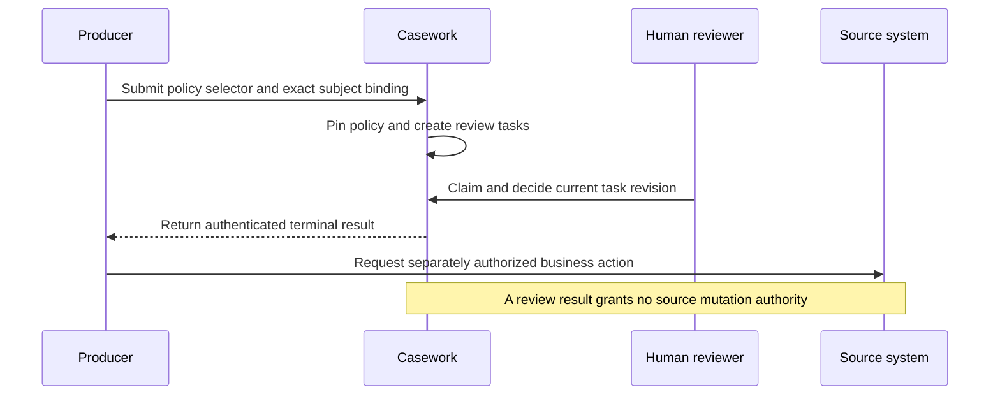

When you integrate Registry Casework, your producer owns the subject and the business action;
Casework owns the human review round. The same review model works with an admitted snapshot or
current context disclosed by a source.

{/* Evidence: products/casework/README.md;
    crates/registry-casework-core/src/review.rs;
    crates/registry-review-protocol/src/lib.rs. */}

## One review round

A `ReviewPolicy` declares context requirements, ordered stages, eligible profiles, independent
reviewer thresholds, outcomes, routing, clocks, and retention.
A trusted producer creates a `ReviewRequest` selecting the policy by ID, with an immutable subject
binding and an idempotency key. The producer can also require an exact version and digest.
Casework atomically binds acceptance to the selected policy's concrete ID, version, and digest.
The producer cannot select a reviewer or invent a stage.

Casework creates `ReviewTask`s as the pinned stages become active.
Eligible humans claim or receive tasks and record `Decision`s under the current task revision.
A stage advances only when its pinned threshold and exclusion rules are satisfied.
A terminal `ReviewResult` repeats the policy, subject, and submission digest so the producer can
correlate the answer with the round it actually submitted.

Changing a policy does not reinterpret accepted requests.
Activation refuses changes that would strand open reviews or replace their required authority.
A producer may cancel its own pending request; a later round may supersede an older round under the
same admitted producer and subject identity.
Neither terminal status means that an external system applied a change.

{/* Evidence: crates/registry-casework/src/review.rs;
    crates/registry-casework/src/pinned_work.rs;
    crates/registry-casework/tests/review_acceptance_postgres.rs;
    crates/registry-review-protocol/src/lib.rs, PolicySelection, ReviewRequestAccepted;
    crates/registry-casework/tests/breg_review_journey.rs. */}

## Two context custody choices

Submitted context is a bounded immutable snapshot validated against the pinned display schema.
It lets you run Casework without a source provider.
The snapshot is review input, not current source authority.

Current-source context is an exact provider and contract binding.
Casework retains the reference and derived task metadata rather than the business projection.
A human display read uses the person's current bearer token and selected source profile.
A service-status credential can establish reviewability but cannot supply displayed fields.
Routing and task-grant context are separate purpose-specific capabilities, required only by policies
that actually use them.

If the source conceals the subject or its version no longer matches, Casework omits it from lists
and refuses open work and context rather than releasing stale source data. A retained decided task
and settled history remain readable under current Casework authority until retention expires; they
contain Casework-owned state, not a cached source projection.
An unavailable provider does not become permission to use a service credential for human disclosure.

{/* Evidence: crates/registry-casework-core/src/adapter.rs;
    crates/registry-casework-core/src/config.rs;
    crates/registry-casework/src/review.rs;
    crates/registry-casework-breg/src/lib.rs. */}

## Current authority around pinned behavior

The policy fixes what a review means; current authentication, Directory membership, queue service,
reviewer exclusions, and source disclosure determine who can act now.
Each request selects one access profile. Scopes from different profiles are not combined.
Staff and Supervisors need the issuer's human-actor assertion; a producer is a separate calling system.
Operator activation manages deployment. Administrator authority manages Directory and calendar
state without granting a review decision.

Claims, assignments, delegation, decisions, and caseload moves check revisions and eligibility inside
the committing transaction.
An exact caseload preview applies atomically, so a stale selection cannot silently become a partial
move. Absence cover is resolved under current eligibility, with retained accountability for the change.
Private drafts remain private to their holder and do not become producer-visible result fields.

{/* Evidence: crates/registry-casework/src/auth.rs;
    crates/registry-casework/src/review.rs;
    crates/registry-casework/src/review/staffing.rs;
    crates/registry-casework/tests/review_acceptance_postgres.rs. */}

## Clocks and operational recovery

Clocks measure a subject or review activity against the pinned policy and calendar.
Reminders and due steps change local review metadata or the serving queue; they decide no outcome and
apply nothing at the source. Missing required source or holiday facts defer the affected calculation.
An Administrator reviews and applies clock recomputation rather than silently changing a running
calculation when holiday data changes.

Sensitive mutations and accountability disclosure use the audit destination as a release gate.
A lost response is an unknown outcome, so a producer retries the same request and key or reads its
accepted request. The original selector remains part of the submission identity; retrying an
ID-only selection after a policy update recovers the original concrete binding.
The producer still needs current authority. It does not create a new round merely to recover the
old answer.
Human mutations also retain keyed receipts; a stale revision requires a fresh read before a new action.

{/* Evidence: crates/registry-casework/src/review/maintenance.rs;
    crates/registry-casework/src/review/staffing.rs;
    crates/registry-casework/src/audit.rs;
    crates/registry-casework/tests/review_acceptance_postgres.rs. */}

## Retained results and accountability

The producer receives a minimized terminal result without raw reviewer identity, private reasons,
or drafts. A separately authorized Supervisor may resolve protected accountability while it is
retained, and that disclosure is audited.

`terminalRetentionDays` bounds producer-visible result retention; `accountabilityRetentionDays` bounds protected
accountability and is at least as long. Maintenance erases expired state according to the pinned
policy. Minimal replay state and independent audit retention have their own boundaries.
[Retention in Casework](../../operate/casework-retention/) explains what expires and how you verify
that maintenance is progressing.

{/* Evidence: crates/registry-casework/src/review/maintenance.rs;
    crates/registry-casework/src/review.rs;
    products/casework/contracts/security-invariant-matrix.yaml. */}

## Next

- [Author a Casework policy](../../configure/casework/) for stages and context requirements.
- [Deploy Registry Casework](../../operate/casework/) for package activation and recovery.
- [Registry Casework API](../../reference/apis/registry-casework/) for exact request contracts.
